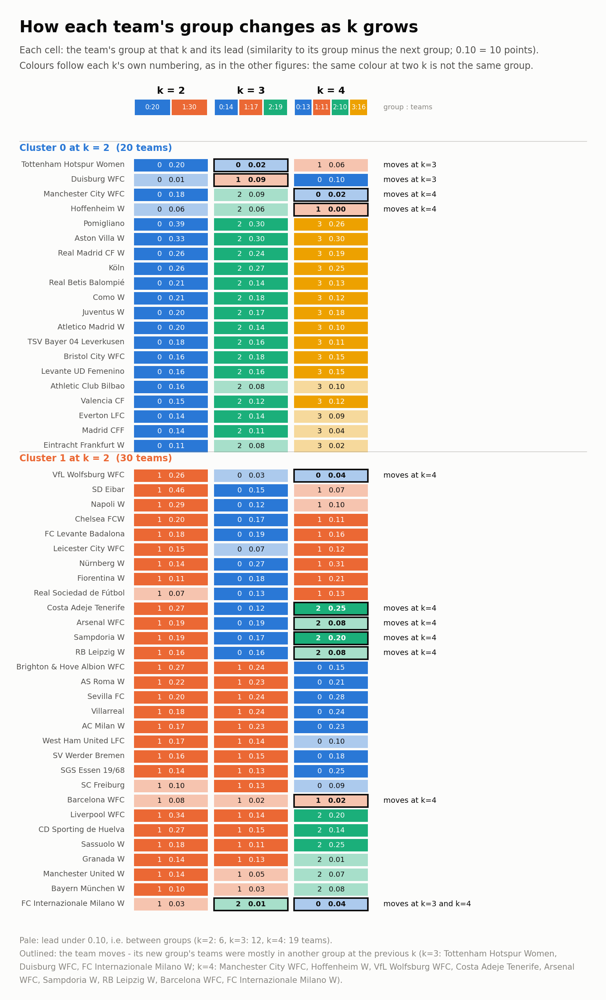
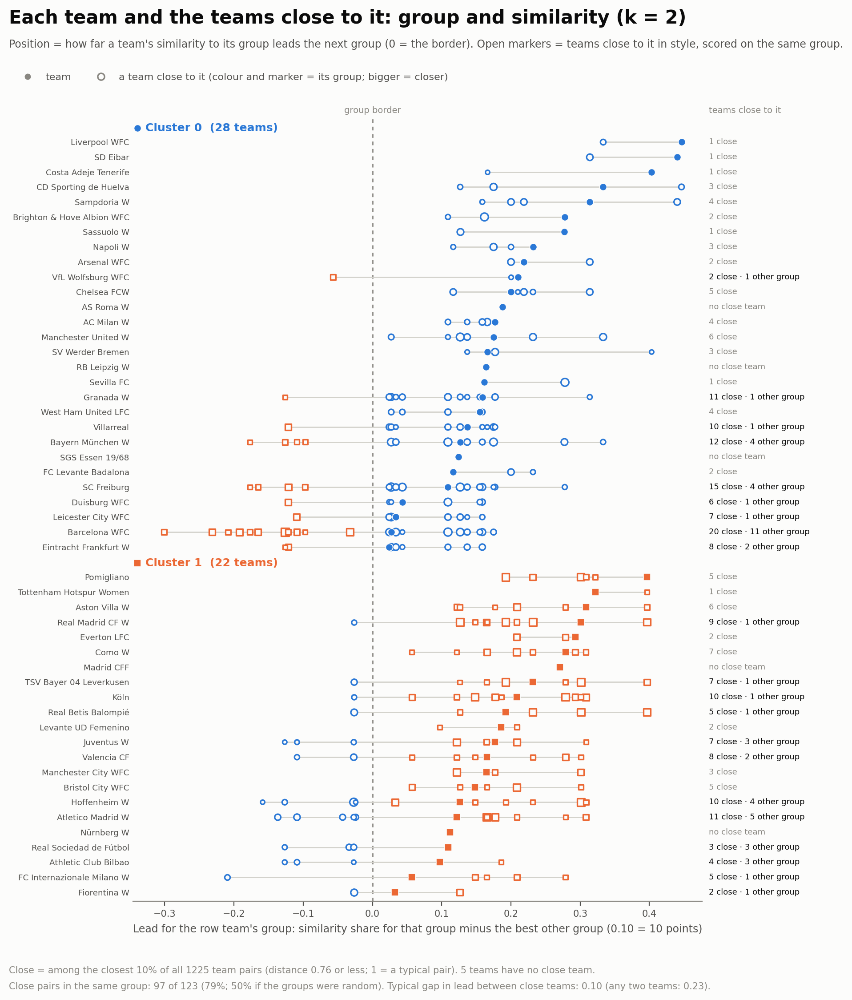
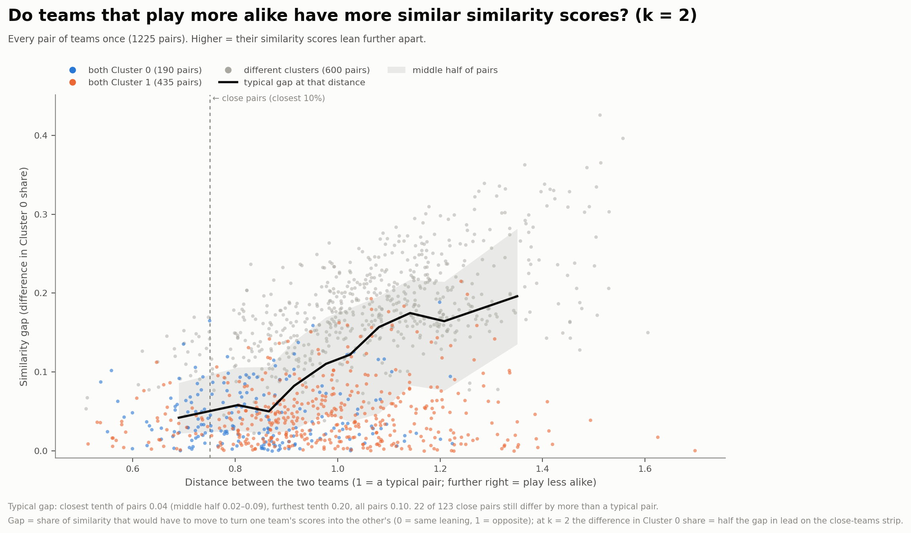
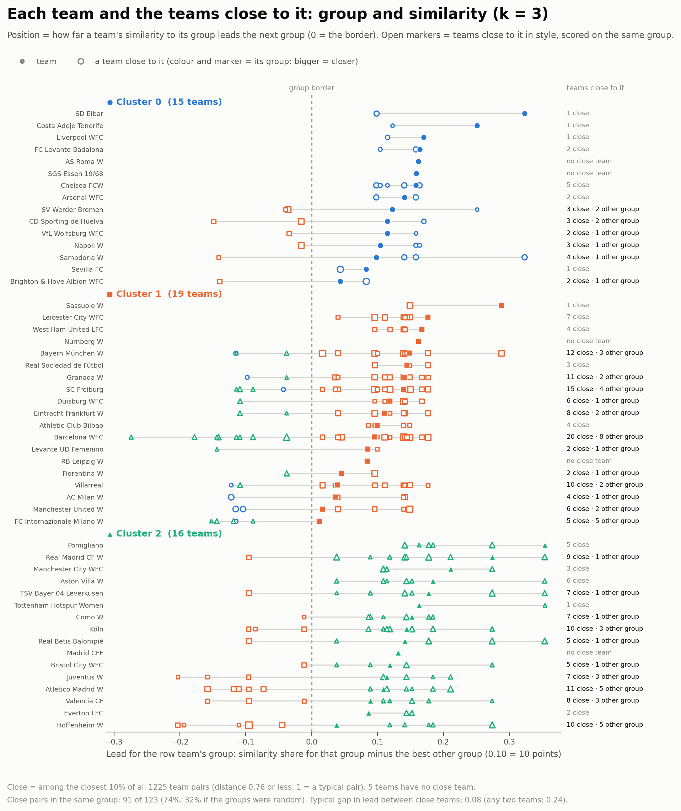
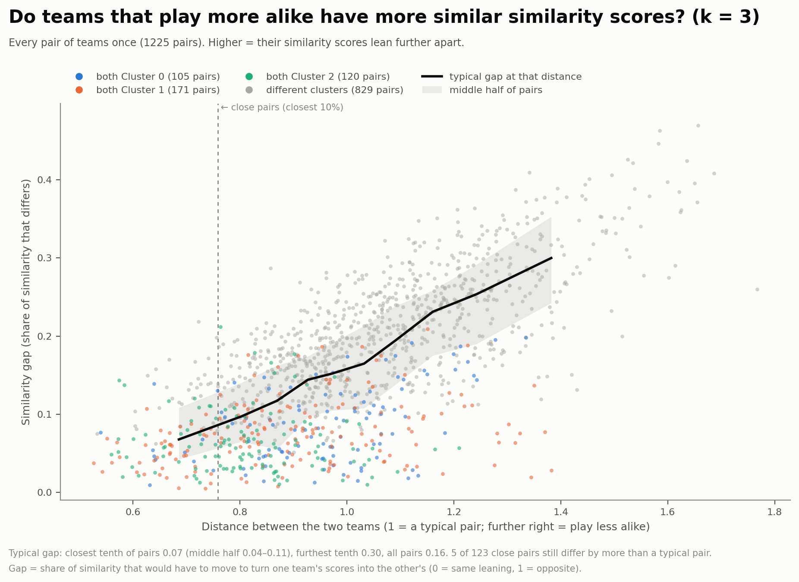
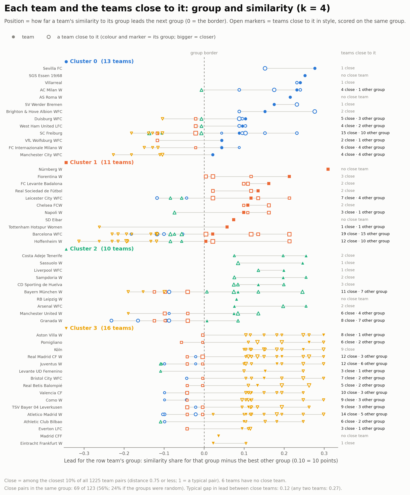
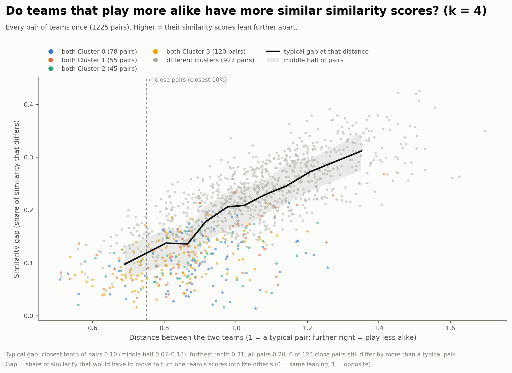

# Team clustering results vs Team style distance

In this section, we will examine the relationship between team clusters and distance between teams in terms of playing style.

Among 50 teams, there are 1225 team pairs.

Taking the closest 10% of team pairs gives 123 pairs.

## Do teams that play alike get clustered in the same cluster?

If teams were put in clusters at random while cluster sizes are preserved,

- 50% of pairs would land in the same cluster for k = 2
- 32% of pairs would land in the same cluster for k = 3
- 25% of pairs would land in the same cluster for k = 4

Among the 123 close pairs,

- 97 pairs (79%) landed in the same cluster for k = 2
- 91 pairs (74%) landed in the same cluster for k = 3
- 79 pairs (64%) landed in the same cluster for k = 4

Close teams also sit at similar distances from their cluster border, in particular,

- For k = 2, a typical gap between two close teams is 0.10, while between any two teams is 0.23
- For k = 3, a typical gap between two close teams is 0.08, while between any two teams is 0.24
- For k = 4, a typical gap between two close teams is 0.10, while between any two teams is 0.27

Therefore, teams play alike mostly land in the same cluster, well above chance.

## How tight are clusters

A cluster is tight when many pairs of its teams are close. Since 10% of all pairs are close, a cluster of above 10% is tighter than a random group of teams.

| k | Cluster | Teams | Close pairs inside the cluster | Share of its pairs |
| --- | --- | --- | --- | --- |
| 2 | 0 (front-foot) | 28 | 54 of 378 | 14% |
| 2 | 1 (patient) | 22 | 43 of 231 | 19% |
| 3 | 0 (direct) | 15 | 11 of 105 | 10% |
| 3 | 1 (passing) | 19 | 44 of 171 | 26% |
| 3 | 2 (patient) | 16 | 36 of 120 | 30% |
| 4 | 0 (central) | 8 | 4 of 28 | 14% |
| 4 | 1 (passing) | 11 | 32 of 55 | 58% |
| 4 | 2 (direct) | 17 | 13 of 136 | 10% |
| 4 | 3 (patient) | 14 | 30 of 91 | 33% |

- Patient teams are tight at every k, and the tightness grows at further k.
- At k = 4 the passing cluster is the tightest, while direct teams are the loosest. Eventually most of the direct teams have very few neighbours, or even none.
- The central cluster at k = 4 is small and loose.
- There are 5 teams without neighbours, 3 of them were front footed (AS Roma W, RB Leipzig W, and SGS Essen 19/68). The other two teams that land in patient cluster were Madrid CFF and Nurnberg W. Also, most of these teams are quite firm members within their clusters, apart from RB Leipzig W at k = 3 and k = 4.
- The three teams with the most neighbours are Barcelona WFC (20), SC Freiburg (15), and Bayern Munchen W (12). All of them are front-footed at k = 2, passing teams at k = 3, and open play build up front-footed teams at k = 4.

Subsequently, at k = 4, patient and passing teams play quite alike, while direct teams are more varied in how they played, and the central cluster is the least clearly grouped.

## Where do clusters meet?

A close pair that sits across two clusters shows where their borders blur. Since 10% of all pairs are close, two clusters with a share near 10% overlap as much as random teams would.

| k | Clusters | Close pairs between them | Share of pairs between them |
| --- | --- | --- | --- |
| 2 | 0 (front-foot) and 1 (patient) | 26 of 616 | 4% |
| 3 | 1 (passing) and 2 (patient) | 24 of 304 | 8% |
| 3 | 0 (direct) and 1 (passing) | 8 of 285 | 3% |
| 3 | 0 (direct) and 2 (patient) | 0 of 240 | 0% |
| 4 | 1 (passing) and 3 (patient) | 16 of 154 | 10% |
| 4 | 0 (central) and 1 (passing) | 9 of 88 | 10% |
| 4 | 0 (central) and 3 (patient) | 9 of 112 | 8% |
| 4 | 1 (passing) and 2 (direct) | 9 of 187 | 5% |
| 4 | 2 (direct) and 3 (patient) | 1 of 238 | 0.4% |
| 4 | 0 (central) and 2 (direct) | 0 of 136 | 0% |

- At k = 2, 26 pairs cross the patient/front-foot border (4% of the pairs across it), against 14% inside the front foot cluster and 19% inside the patient cluster.
- At k = 3, the passing cluster sits in the middle, meeting the patient cluster more than the direct cluster (24 against 8). Direct teams and patient teams never form a close pair.
- At k = 4, the passing cluster touches every other cluster, in which it overlaps the patient and central clusters as much as random teams would (10%), and then direct cluster much less (5%). The central cluster also meets the patient cluster at 9 pairs. The direct cluster is the furthest out, as it only really touches the passing cluster at 9 pairs but only 1 with the patient cluster and none with the central cluster.
- Barcelona WFC, Hoffenheim W, Atletico Madrid W, SC Freiburg, and Bayern Munchen W are the teams with the most close teams in other clusters every k. At k = 3, all FC Internazionale Milano W's neighbours are in other clusters.
- Consequently, at k = 3 the style runs from direct to passing to patient, with passing teams at the middle. While at k = 4, the passing cluster is the hub, the direct cluster sits furthest out, and the central cluster links the passing and patient teams.

## Similarity gap vs Distance

The similarity gap is the share of similarity that would have to move to turn one team's scores into the other's, with 0 being same leaning and 1 being opposite.

| k | Closest tenth of pairs (middle half) | Furthest tenth of pairs | Any two teams | Close pairs with a bigger gap than any two teams |
| --- | --- | --- | --- | --- |
| 2 | 0.05 (0.02 to 0.08) | 0.26 | 0.12 | 12 of 123 |
| 3 | 0.07 (0.04 to 0.11) | 0.30 | 0.16 | 5 of 123 |
| 4 | 0.10 (0.06 to 0.14) | 0.36 | 0.21 | 2 of 123 |

- At all k, the further apart two teams play, the further apart are their similarity scores. The typical gap for the closest tenth of pairs is less than half that of any two teams, with the furthest tenth around double.
- At k = 2, the gap stays under 0.09 up to a distance of about 0.9, before climbing faster to 0.26 for further pairs.
- On the other hand, at k = 3 and k = 4, the rise is more steady as more clusters tell what kind of front foot a team resembles.
- Very few close pairs have a larger gap than any two teams. At k = 2, most of the 12 look like pairs from different clusters, which are teams near the border.
- The link runs one way, as teams that play alike tend to have similar scores, but similar scores do not mean similar playstyle. Many teams from the same cluster are far apart in style yet have a small similarity gap. At k = 4 many of these pairs are from cluster 2 (direct), which fits the direct cluster being the loosest.
- Hence, a large gap in similarity scores mean two teams play differently, while a small gap only indicates that the two teams lean the same way. At higher k, gaps are large because there are more clusters to differ accross, so comparisons are only valid within each k rather than across different values of k.

## Do teams stay in their cluster as k goes up?

Going from k = 2 to k = 4, each team follows a path through three sets of clusters. At k = 4 every cluster fits inside one of the two k = 2 clusters, so a team can only change side at k = 3.

| Path (k = 2, k = 3, k = 4) | Teams |
| --- | --- |
| Front-foot, direct, direct | 15 |
| Front-foot, passing, passing | 11 |
| Front-foot, passing, direct | 2 (Manchester United W, RB Leipzig W) |
| Patient, patient, patient | 11 |
| Patient, patient, central | 5 (Tottenham Hotspur Women, Hoffenheim W, Madrid CFF, Real Betis Balompié, Pomigliano) |
| Patient, passing, patient | 3 (FC Internazionale Milano W, Athletic Club Bilbao, Levante UD Femenino) |
| Patient, passing, central | 3 (Fiorentina W, Real Sociedad de Fútbol, Nürnberg W) |

- The direct cluster was the most stable throughout, with all 15 teams at k = 3 being still direct at k = 4, and only 2 teams joining from the passing cluster.
- The patient cluster mostly holds. 16 of 22 teams stay patient at k = 3, and 11 of those are still patient at k = 4. The other 5 teams form the core of the central cluster.
- The passing cluster at k = 3 is the only place where teams change side with 13 front foot teams and 6 patient teams, which fits it being the middle zone between the other two clusters. At k = 4 all 6 teams returned to the patient side, with 3 joining the patient cluster and 3 joining the central cluster.
- Teams on cluster borders are not the ones that switch. Barcelona FCW, SC Freiburg, and Bayern Munchen W stay passing at k = 3 and k = 4, while Atletico Madrid W stay patient at every k. FC Internazionale Milano W, on the other hand, had all five of its k = 3 neighbours in other clusters, and at k = 4 it goes back to the patient cluster, where four of its neighbours are.
- Subsequently, while the direct cluster is the firmest across every k, the patient cluster holds apart from a few teams.

## Appendix

<a href="#team-clustering-results-vs-team-style-distance">&#8593; Back to main text</a>

### A1. Team paths across k

  

<em>Figure A1. Each team's cluster from k = 2 to k = 4. A team moves when it leaves the cluster that most of its previous cluster went to; 16 teams stay patient at every k.</em>

<a href="#team-clustering-results-vs-team-style-distance">&#8593; Back to main text</a>

### A2. k = 2

  
  

<em>Figure A2. Left: each team's lead for its own cluster, with the teams close to it in style (open markers) scored on the same cluster. Right: similarity gap against style distance for all 1,225 pairs. At k = 2, 95 of the 123 close pairs share a cluster (77%, against 51% by chance), and the typical similarity gap is 0.04 for the closest tenth of pairs against 0.20 for the furthest.</em>

<a href="#team-clustering-results-vs-team-style-distance">&#8593; Back to main text</a>

### A3. k = 3

  
  

<em>Figure A3. Left: each team's lead for its own cluster at k = 3, with the teams close to it in style (open markers) scored on the same cluster. Right: similarity gap against style distance for all 1,225 pairs. 90 of the 123 close pairs share a cluster (73%, against 32% by chance), and the typical similarity gap is 0.08 for the closest tenth of pairs against 0.26 for the furthest.</em>

<a href="#team-clustering-results-vs-team-style-distance">&#8593; Back to main text</a>

### A4. k = 4

  
  

<em>Figure A4. Left: each team's lead for its own cluster at k = 4, with the teams close to it in style (open markers) scored on the same cluster. Right: similarity gap against style distance for all 1,225 pairs. 69 of the 123 close pairs share a cluster (56%, against 24% by chance), and the typical similarity gap is 0.10 for the closest tenth of pairs against 0.31 for the furthest.</em>

