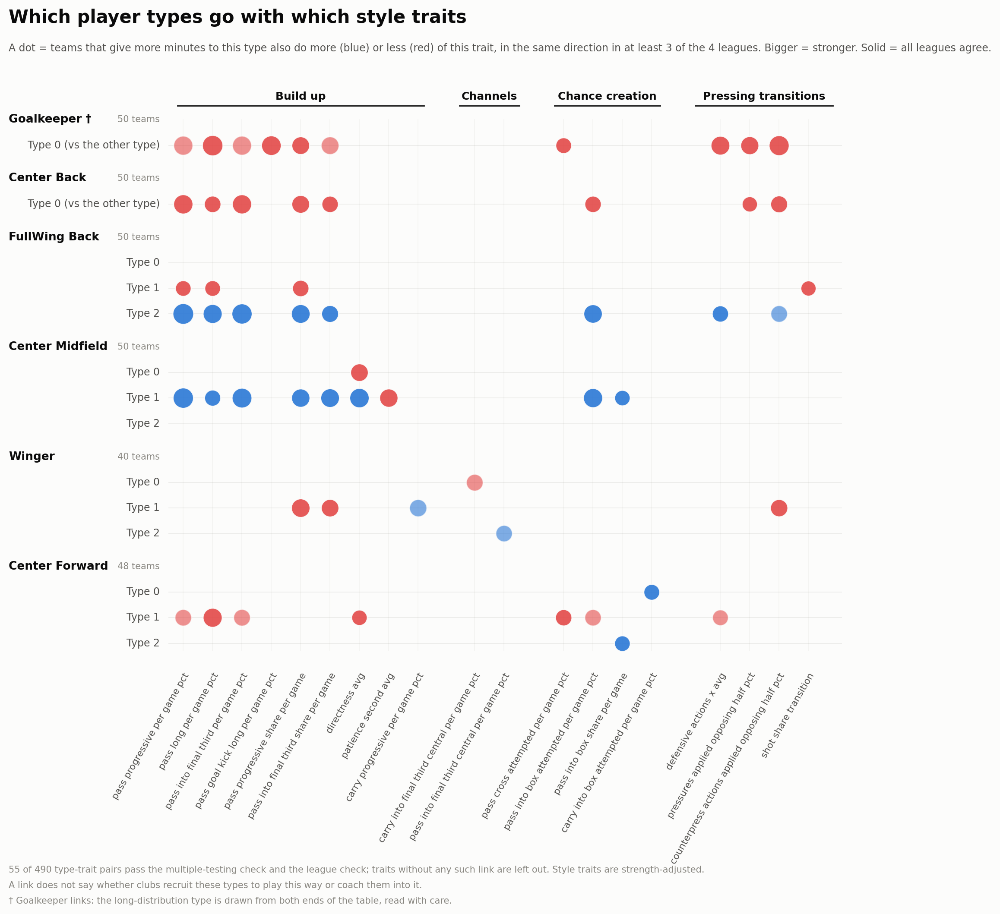
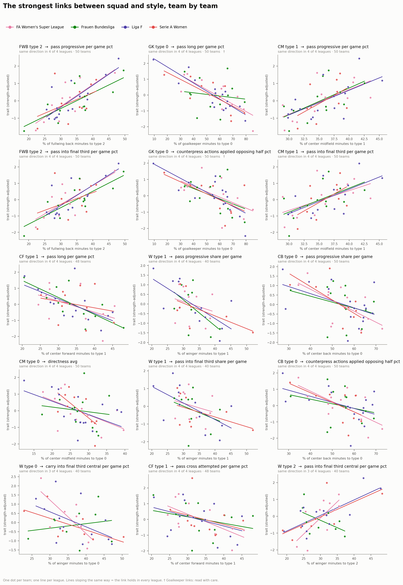

# Style features vs Team squad composition

Are style features and team squad composition related?

For every player type and style trait, we checked whether teams giving more minutes to a certain type also show more or less of that trait. A link only counts if it survives a check for the large number of comparisons and points the same way in at least 3 leagues, in which 55 type-trait pairs pass out of 490.

## Which player types go with which style traits?

- Goalkeepers: Teams giving more minutes to short-passing keepers play fewer long goal kicks and long passes, while attempt less crosses and presses.
- Center Backs: Teams giving more minutes to line holding center backs tend to go less forward and less progressive, pass less into the box, and press less.
- Full/Wing Backs: Progressive passing wingbacks go with more progressive, long, into the final third, and into box passes, while deep full backs go with less pass progression and shots from transitions.
- Center Midfields: Progressive passers go with more progressive, final third, and box passing and more direct play; advanced carriers go with less direct attacks.
- Wingers: Wide midfielders go with less progression via with passing and less counterpressing.
- Center Forwards: Poacher-style forwards go with less long balls, crosses, and directness; advanced forwards go with more carries into the box, while target forwards go with more box entries via pass.

Therefore, the types patient teams use go with patient traits, while the types front-foot teams use go with front foot traits.

## Do the links fit what each type does?

- Every link points the same direction as the type's own description suggests, although some are partly automatic because the type's own actions feed the team's numbers, such as keepers' long goal kicks or wingbacks' progressive passing.
- While other are team links, where the type rarely does the actions, namely goalkeepers with crosses and pressing, center backs with passes into box, poachers with fewer crosses, and target forwards with more balls into the box.

## Traits with no links

Almost none of channel traits or chance creation traits link to any player type. Hence, which flank a team attacks or how it creates chances do not come from the type of players the team pick.

## Does it agree with the squad mix by cluster?

- Yes, the types going with patient traits are the types patient teams give more minutes to, and the same goes for front-foot side.

## Caveats

- The links do not mean whether clubs pick types to fit a certain style or coach players into it.
- Own action links are partly built in.
- Long distribution keepers draw from both the top and bottom of the table, so keeper links need care when interpreting.
- Winger links rest on only 40 teams, while center forward links rest on only 48.

## Appendix

  

<em>Figure 1. Links between player-type minute shares and style traits. A link counts only if it passes the check for the large number of comparisons and points the same way in at least 3 of 4 leagues (55 of 490 type-trait pairs).</em>

  

<em>Figure 2. The 15 strongest type-trait links (at most 2 per style trait), one panel per pair: each dot is a team, placed by its share of minutes for the player type and its value for the style trait.</em>

